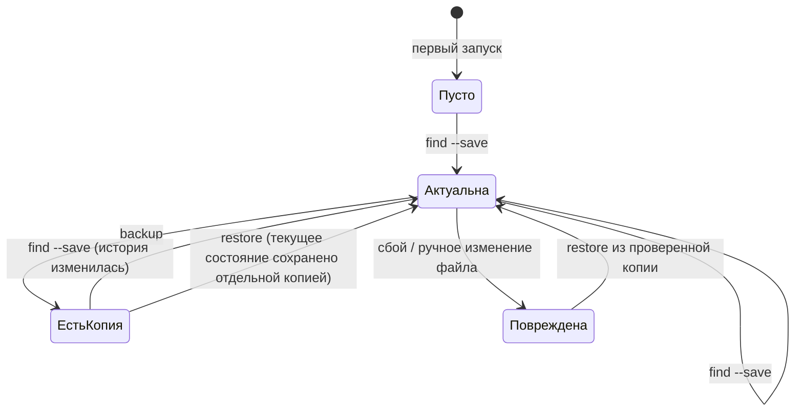
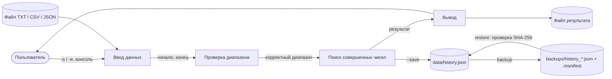
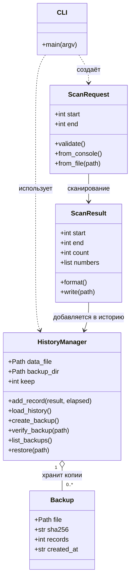
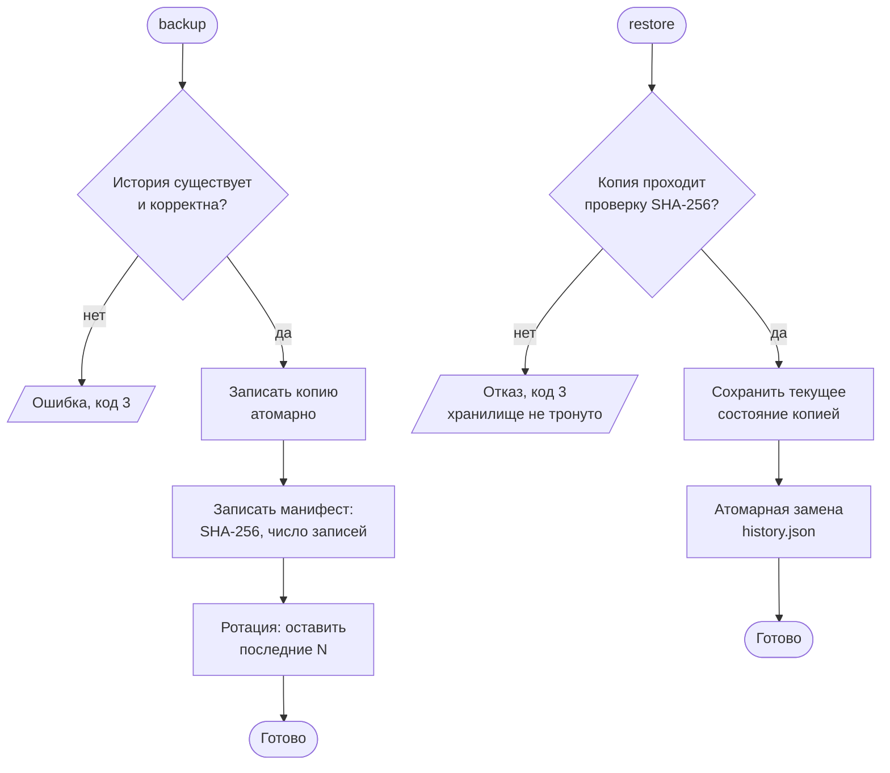

**МИНИСТЕРСТВО НАУКИ И ВЫСШЕГО ОБРАЗОВАНИЯ РОССИЙСКОЙ ФЕДЕРАЦИИ**
*[Полное наименование учебного заведения]*
*[Кафедра / отделение]*

&nbsp;

**УТВЕРЖДАЮ**
*[Должность, ФИО руководителя]*
«___» ____________ 2026 г.

&nbsp;

# ТЕХНИЧЕСКОЕ ЗАДАНИЕ

## на разработку программного средства «perfect-numbers-tool»

### Поиск совершенных чисел в заданном диапазоне с подсистемой резервного копирования и восстановления истории сканирования числовых осей

&nbsp;

| | |
|---|---|
| **Исполнитель** | *[ФИО, группа]* |
| **Руководитель** | *[ФИО, должность]* |
| **Версия документа** | 1.0 |
| **Дата** | 21.10.2026 |
| **Стандарты оформления** | ГОСТ 19.201-78 (ТЗ), ГОСТ 19.101-77, ГОСТ 19.106-78; структура разделов — IEEE Std 830 |

---

## Содержание

1. [Требования заказчика (введение)](#1-требования-заказчика-введение)
2. [Требования разработчика: общее описание](#2-требования-разработчика-общее-описание)
3. [Требования разработчика: детальные требования](#3-требования-разработчика-детальные-требования)
4. [Приложения](#4-приложения)

---

# 1. Требования заказчика (введение)

*Раздел написан на понятном заказчику языке. Он фиксирует общие желания и потребности (C-требования) и служит основой для детальных D-требований раздела 3.*

## 1.1 Цель

Настоящее техническое задание (ТЗ) определяет требования к программному средству (ПС) **perfect-numbers-tool** — консольной программе на языке Python, которая находит все **совершенные числа** в диапазоне, заданном пользователем, и ведёт **историю сканирований числовых осей** с возможностью её резервного копирования и восстановления.

Документ предназначен для:

- **заказчика** — для проверки того, что его потребности записаны верно;
- **разработчика** — как база для проектирования, реализации и тестирования;
- **тестировщика** — для составления тест-кейсов и приёмки;
- **сопровождающего** — для понимания ограничений и регламента обслуживания.

## 1.2 Область применения

**Название продукта:** `perfect-numbers-tool` (пакет `perfect_numbers`, версия 1.0.0).

**Совершенное число** — натуральное число, равное сумме всех своих положительных делителей, исключая само число. Пример: 6 = 1 + 2 + 3; 28 = 1 + 2 + 4 + 7 + 14.

**ПС должно:**

- находить все совершенные числа в диапазоне `[начало; конец]`, заданном пользователем;
- принимать диапазон через консоль, через аргументы командной строки и через файл (TXT, CSV, JSON);
- выводить результат в консоль и, по желанию, в файл (TXT или JSON);
- сохранять каждое выполненное сканирование в **историю** (диапазон, найденные числа, дата, время расчёта);
- создавать **резервные копии** истории с контролем целостности и восстанавливать историю из копии.

**ПС не должно** (см. также раздел 3.4): иметь графический интерфейс, работать по сети, искать числа вне разрешённых пределов диапазона, изменять входные файлы.

**Основные преимущества и достигаемые цели:**

- быстрый и проверяемый расчёт (диапазон 1…1 000 000 — около одной секунды);
- защита накопленной истории от потери и повреждения;
- отсутствие внешних зависимостей — программа запускается «из коробки» на любой ОС с Python 3.10+;
- полный комплект документации и тестов, зафиксированный в репозитории GitHub.

### Требования заказчика (C-требования)

| ID | Требование заказчика | Приоритет |
|---|---|---|
| **C-01** | Находить все совершенные числа в диапазоне, заданном пользователем | Обязательное |
| **C-02** | Принимать данные через консоль и через файл | Обязательное |
| **C-03** | Выдавать результат в консоль и в файл | Обязательное |
| **C-04** | Хранить историю сканирований числовых осей | Обязательное |
| **C-05** | Создавать резервные копии истории | Обязательное |
| **C-06** | Восстанавливать историю из резервной копии | Обязательное |
| **C-07** | Не терять и не портить данные при сбоях; обнаруживать повреждённые копии | Обязательное |
| **C-08** | Работать без установки сторонних библиотек на Windows, Linux и macOS | Обязательное |
| **C-09** | Иметь документацию: ТЗ, README на русском и английском, регламент технического обслуживания; хранить всё в GitHub | Обязательное |
| **C-10** | Иметь тест-кейсы и подтверждение соответствия ПС данному ТЗ | Обязательное |

## 1.3 Определения, термины, сокращения

| Термин | Определение |
|---|---|
| ПС | Программное средство |
| ТЗ | Техническое задание |
| C-требования | Требования заказчика (общие потребности, раздел 1) |
| D-требования | Детальные требования разработчика (раздел 3) |
| Совершенное число | Натуральное число, равное сумме своих положительных делителей, кроме самого числа: σ(n) − n = n |
| Собственные делители | Положительные делители числа, не равные самому числу |
| Числовая ось, диапазон | Отрезок натурального ряда `[начало; конец]` с включёнными границами |
| Сканирование | Однократный поиск всех совершенных чисел в заданном диапазоне |
| История | Журнал выполненных сканирований (файл `data/history.json`) |
| Резервная копия | Копия файла истории в каталоге `backups/` вместе с манифестом |
| Манифест | Файл `*.manifest` с SHA-256, числом записей, размером и датой создания копии |
| Ротация | Автоматическое удаление старейших копий сверх лимита `--keep` |
| Атомарная запись | Запись через временный файл с последующей заменой; сбой не оставляет наполовину записанный файл |
| SHA-256 | Криптографическая хеш-функция, используется для контроля целостности копий |
| CLI | Интерфейс командной строки |
| TXT, CSV, JSON | Форматы файлов ввода/вывода |
| CI | Непрерывная интеграция (GitHub Actions) |
| IEEE 830 | Стандарт структуры спецификации требований к ПО |

## 1.4 Ссылки

| № | Документ | Использование |
|---|---|---|
| 1 | ГОСТ 19.201-78. ЕСПД. Техническое задание. Требования к содержанию и оформлению | Оформление ТЗ |
| 2 | ГОСТ 19.101-77. ЕСПД. Виды программных документов | Состав документации |
| 3 | ГОСТ 19.106-78. ЕСПД. Требования к программным документам, выполненным печатным способом | Оформление |
| 4 | IEEE Std 830-1993 (830-1998). Recommended Practice for Software Requirements Specifications | Структура ТЗ |
| 5 | ГОСТ Р 59793-2021 (ГОСТ 34.601-90). Стадии создания автоматизированных систем | Этапы разработки |
| 6 | Python Documentation 3.10+ (docs.python.org) | Стандартная библиотека |
| 7 | FIPS PUB 180-4. Secure Hash Standard (SHA-256) | Контроль целостности |
| 8 | Euclid. Elements, Book IX, Prop. 36 (чётные совершенные числа) | Проверка результатов |
| 9 | README.md / README.en.md; `docs/maintenance.md`; `docs/test-cases.md`; `docs/GIT.md` | Сопутствующая документация проекта |

Все документы проекта находятся в репозитории: `https://github.com/<ваш-логин>/perfect-numbers-tool`.

## 1.5 Краткое описание

Оставшаяся часть ТЗ организована следующим образом:

- **Раздел 2 «Общее описание»** — место ПС среди других систем, интерфейсы (системный, пользовательский, аппаратный, программный, коммуникационный), функциональное описание, характеристики пользователей, ограничения, допущения и приоритеты.
- **Раздел 3 «Детальные требования»** — пронумерованные D-требования с перекрёстными ссылками на C-требования и тест-кейсы: функциональные, нефункциональные (производительность, надёжность и безопасность, обработка ошибок, интерфейсные, ограничения) и обратные.
- **Раздел 4 «Приложения»** — форматы файлов, коды возврата, матрица трассируемости.

---

# 2. Требования разработчика: общее описание

## 2.1 Обзор ПС

`perfect-numbers-tool` — **автономное** консольное приложение. Оно не является компонентом более крупной системы, не требует сервера, базы данных или сети. Все данные хранятся в локальных файлах (JSON). Состав ПС:

| Модуль | Назначение |
|---|---|
| `core.py` | Проверка диапазона, расчёт сумм делителей, поиск совершенных чисел |
| `io_handlers.py` | Ввод (консоль, TXT, CSV, JSON) и вывод (консоль, TXT, JSON) |
| `backup.py` | Хранилище истории, создание и проверка копий, ротация, восстановление |
| `cli.py` | Разбор командной строки, коды возврата, связывание модулей |

### 2.1.1 Системный интерфейс

ПС взаимодействует только с файловой системой и стандартными потоками ОС:

| Интерфейс | Направление | Назначение |
|---|---|---|
| `stdin` | Ввод | Интерактивный ввод границ диапазона |
| `stdout` | Вывод | Результат сканирования, списки, сообщения |
| `stderr` | Вывод | Сообщения об ошибках |
| Файловая система | Ввод/вывод | Входные файлы, выходные файлы, `data/history.json`, `backups/*` |
| Код возврата процесса | Вывод | 0 / 1 / 2 / 3 (приложение Б) |

Диаграмма состояний хранилища истории и копий:



### 2.1.2 Пользовательский интерфейс

Интерфейс — командная строка. Запуск: `python -m perfect_numbers <команда> [параметры]`.

| Команда | Описание |
|---|---|
| `find` | Найти совершенные числа (ввод: консоль / `-s -e` / `-i файл`; вывод: консоль / `-o файл`; `--save` — в историю) |
| `history` | Показать историю сканирований (`--limit N`) |
| `backup` | Создать резервную копию истории |
| `list-backups` | Список копий с проверкой целостности |
| `verify` | Проверить целостность всех копий |
| `restore` | Восстановить историю (`--file` — из указанной копии, иначе из самой свежей) |

Пример диалога при консольном вводе:

```
$ python -m perfect_numbers find
Введите начало диапазона: 1
Введите конец диапазона: 10000
Диапазон: 1 – 10000
Найдено совершенных чисел: 4
Числа: 6, 28, 496, 8128
```

Сообщения интерфейса — на русском языке; ошибки выводятся в `stderr` с префиксом «Ошибка:».

### 2.1.3 Аппаратный интерфейс

Специальных устройств, портов и протоколов не используется. Требуется только доступ к дисковой подсистеме (чтение/запись файлов) и стандартным потокам ввода-вывода. Конфигурация оборудования — любой ПК, поддерживающий Python 3.10+ (рекомендуется: 1 ядро ЦП, 1 ГБ ОЗУ).

### 2.1.4 Программный интерфейс

| Внешнее ПС | Версия | Используемые функции | Назначение |
|---|---|---|---|
| Python | 3.10 и выше | интерпретатор | Среда выполнения |
| `argparse` | stdlib | `ArgumentParser`, `add_subparsers` | Командная строка |
| `json` | stdlib | `loads`, `dumps` | Файлы истории, манифесты, JSON-ввод/вывод |
| `hashlib` | stdlib | `sha256` | Контрольные суммы копий |
| `pathlib` | stdlib | `Path` | Работа с путями |
| `tempfile`, `os` | stdlib | `mkstemp`, `fsync`, `replace` | Атомарная запись |
| `math` | stdlib | `isqrt` | Целочисленный квадратный корень |
| `array` | stdlib | `array('Q')` | Компактное хранение сумм делителей |
| `datetime`, `time` | stdlib | `now`, `perf_counter` | Метки времени, замер длительности |
| `unittest` / `pytest` | — | — | Автотесты (только для разработки) |

Внешние (сторонние) библиотеки **не используются**.

### 2.1.5 Коммуникационный интерфейс

Сетевые и иные средства связи не используются. Работа с GitHub (хранение исходных кодов и документации, CI) выполняется средствами Git вне ПС.

### 2.1.6 Ограничения по памяти

| Ресурс | Требование |
|---|---|
| Оперативная память | Не более 100 МБ при максимальной длине диапазона (5 000 000 чисел занимают ≈ 40 МБ; измеренный пик — 47 МБ) |
| Внешняя память | Дистрибутив — менее 1 МБ; история и копии: размер одной копии ≈ размеру истории (десятки КБ на сотни записей); итоговый объём ≤ (`keep` + 1) × размер истории |

### 2.1.7 Операции

К специфическим операциям, необходимым пользователю, относятся:

1. **Резервное копирование** истории — команда `backup` (с манифестом SHA-256 и ротацией).
2. **Проверка** копий — команды `list-backups` и `verify`.
3. **Восстановление** истории — команда `restore` (с предварительной проверкой копии и сохранением текущего состояния).

Подробный алгоритм — в п. 3.2.5–3.2.6; регламент обслуживания — в `docs/maintenance.md`.

### 2.1.8 Требования к адаптации рабочих мест

- Установленный Python 3.10 или новее (`python --version`).
- Права на чтение/запись в каталоге запуска (создаются `data/` и `backups/`) либо явное указание путей `--data-file`, `--backup-dir`.
- Консоль с поддержкой UTF-8 (в Windows PowerShell при необходимости: `chcp 65001`).
- Перед запуском из каталога проекта без установки: `PYTHONPATH=src` (PowerShell: `$env:PYTHONPATH="src"`) либо `pip install -e .`.

## 2.2 Функциональное описание

Функции сгруппированы по назначению:

| Группа | Функции |
|---|---|
| **Ввод данных** | Ввод из консоли; ввод через аргументы; чтение TXT / CSV / JSON |
| **Расчёт** | Проверка диапазона; вычисление сумм собственных делителей; отбор совершенных чисел |
| **Вывод** | Печать результата; запись в TXT / JSON |
| **История** | Добавление записи; просмотр |
| **Резервирование** | Создание копии; манифест; ротация; проверка; список |
| **Восстановление** | Выбор копии; проверка; сохранение текущего состояния; атомарная замена |

Диаграмма потоков данных:



Алгоритм поиска (сегментное решето сумм делителей): для диапазона `[a; b]` создаётся массив длиной `b − a + 1`, заполненный единицами (делитель 1 есть у всех n > 1). Для каждого `d` от 2 до `⌊√b⌋` и каждого кратного `m = d·q ≥ d²` из диапазона к элементу `m` прибавляются `d` и `q` (если `q = d` — один раз). Число `n` совершенно, если накопленная сумма равна `n`. Сложность — O(L · ln √b), память — O(L), где L — длина диапазона.

## 2.3 Характеристики пользователя

| Параметр | Описание |
|---|---|
| Категории | Студенты и преподаватели математических и ИТ-направлений; исследователи, проверяющие гипотезы о делителях чисел; тестировщики |
| Возраст | 16–60 лет |
| Образование | Среднее специальное / высшее, начальное знакомство с математикой натуральных чисел |
| Техническая квалификация | Умение открыть терминал и ввести команду; установка Python по инструкции |
| Опыт | Не требуется знание Python и программирования; достаточно README |

Администратор/сопровождающий дополнительно владеет основами Git и работы с файлами.

## 2.4 Ограничения

- Язык реализации — Python 3.10+; только стандартная библиотека.
- Диапазон: `1 ≤ начало ≤ конец ≤ 10¹²`, длина диапазона ≤ 5 000 000 чисел.
- Хранилище — локальные файлы JSON в кодировке UTF-8; многопользовательская одновременная запись не поддерживается.
- Контроль целостности (SHA-256) защищает от случайных повреждений; манифест хранится рядом с копией, поэтому ПС **не защищает от умышленной подмены** обоих файлов.
- Безопасность: данные разбираются только через `json` (без `eval`, `pickle`, исполнения кода); ПС не изменяет входные файлы.
- Документация — на русском и английском языках; хранение — GitHub.

## 2.5 Допущения и зависимости

- На компьютере установлен интерпретатор Python 3.10+ и доступно достаточно свободной памяти (≥ 100 МБ).
- Файловая система поддерживает атомарную замену файла (`os.replace`) в пределах одного каталога.
- Системные часы показывают корректное время (имена копий и сортировка при ротации основаны на времени создания).
- Нечётные совершенные числа науке не известны; ПС ищет совершенные числа **в заданном диапазоне перебором**, а не по формуле Евклида–Эйлера, поэтому результат верен и для нечётных чисел, если они там существуют.
- Для пятого известного совершенного числа (33 550 336) и далее используется ограничение длины диапазона — окно нужно задавать вокруг искомых значений.

## 2.6 Распределение требований

| Версия | Требования | Статус |
|---|---|---|
| **1.0 (текущая)** | C-01…C-10: поиск, ввод/вывод через консоль и файлы, история, копирование, восстановление, документация, тесты | Реализовано |
| **1.1 (отсрочено)** | Автоматическое резервное копирование по расписанию; сжатие копий; параметр `--lang en` для сообщений | Отложено |
| **2.0 (отсрочено)** | Многопроцессорный расчёт; графический интерфейс; экспорт истории в CSV | Отложено |

---

# 3. Требования разработчика: детальные требования

*D-требования — непосредственная база для проектирования, реализации и тестирования. Каждое требование имеет уникальный идентификатор, ссылку на C-требование-источник и тест-кейс проверки (TC-xx, см. `docs/test-cases.md`).*

**Способ организации:** комбинация «по особенностям (features)», «по объектам/классам» и «по реакции на ошибки».

## 3.1 Классы анализа

Классы получены из C-требований (существительные → классы/атрибуты, глаголы → операции).



| Класс анализа | Ответственность | Модуль / реализация |
|---|---|---|
| ScanRequest (запрос сканирования) | Границы диапазона, проверка, получение из консоли/файла | `core.validate_range`, `io_handlers.read_range_*` |
| ScanResult (результат) | Найденные числа, форматирование, запись в файл | `core.analyze`, `io_handlers.format_result`, `write_result_file` |
| HistoryManager (хранилище истории) | Запись истории, копирование, проверка, восстановление | `backup.HistoryManager` |
| Backup (копия) | Файл копии, SHA-256, число записей, дата | файлы `history_*.json` + `*.manifest` |
| CLI | Команды, коды возврата | `cli.main` |

## 3.2 Функциональные требования

### 3.2.1 Ввод данных

| ID | Требование | Источник | Тест |
|---|---|---|---|
| **D-IN-1** | При запуске `find` без источников ПС запрашивает в консоли «начало» и «конец» диапазона; при неверном вводе повторяет запрос (до 3 попыток на число), затем завершается с кодом 1 | C-02 | TC-04, TC-36 |
| **D-IN-2** | Параметр `-i/--input` читает диапазон из файла; формат (TXT, CSV, JSON) определяется по расширению; иное расширение — ошибка | C-02 | TC-01…TC-03, TC-37 |
| **D-IN-3** | Параметры `-s/--start` и `-e/--end` задают границы напрямую; указание только одной границы — ошибка | C-02 | TC-05, TC-38 |
| **D-IN-4** | Одновременное указание `-i` и `-s/-e` недопустимо (код 1) | C-02 | TC-29 |
| **D-IN-5** | TXT/CSV: ровно два целых числа; разделители — пробел, запятая, «;», табуляция, перевод строки; пустые строки, строки с `#` и заголовок `start,end` игнорируются; допускается BOM UTF-8 | C-02 | TC-01, TC-02, TC-35 |
| **D-IN-6** | JSON: объект `{"start": a, "end": b}` или список `[a, b]` | C-02 | TC-03, TC-39 |
| **D-IN-7** | Ошибка формата сопровождается понятным сообщением; для TXT/CSV указывается номер строки | C-02 | TC-13 |
| **D-IN-8** | Нецелые значения (дроби, текст, логические) отклоняются | C-02 | TC-13, TC-40 |

### 3.2.2 Расчёт

| ID | Требование | Источник | Тест |
|---|---|---|---|
| **D-CALC-1** | ПС находит все `n ∈ [a; b]`, для которых сумма положительных делителей без самого `n` равна `n`; границы включены; результат — по возрастанию | C-01 | TC-01, TC-06, TC-08 |
| **D-CALC-2** | Допустимый диапазон: целые `1 ≤ a ≤ b ≤ 10¹²`, `b − a + 1 ≤ 5 000 000`; иначе — ошибка диапазона (код 1) | C-01 | TC-09…TC-11 |
| **D-CALC-3** | Число 1 не является совершенным; для диапазона без совершенных чисел результат — пустой список | C-01 | TC-07, TC-08 |
| **D-CALC-4** | Результат сегментного решета совпадает с прямым перебором делителей для любого диапазона | C-01, C-10 | TC-32 |
| **D-CALC-5** | Известные значения: в `[1; 10000]` — 6, 28, 496, 8128; в окне около 33 550 336 — число 33 550 336 | C-01 | TC-02, TC-06 |

### 3.2.3 Вывод данных

| ID | Требование | Источник | Тест |
|---|---|---|---|
| **D-OUT-1** | Результат выводится в консоль тремя строками: «Диапазон», «Найдено совершенных чисел», «Числа» (при отсутствии — «—») | C-03 | TC-01, TC-07 |
| **D-OUT-2** | Параметр `-o/--output` записывает результат в файл; расширение `.json` → JSON `{start, end, count, numbers}`, иначе — текст; недостающие каталоги создаются | C-03 | TC-15 |
| **D-OUT-3** | Сообщения об ошибках выводятся в `stderr` с префиксом «Ошибка:» либо «Ошибка хранилища:» | C-03 | TC-09, TC-18 |

### 3.2.4 История сканирований

| ID | Требование | Источник | Тест |
|---|---|---|---|
| **D-HIST-1** | Параметр `--save` добавляет запись `{id, timestamp, start, end, count, numbers, elapsed}`; `id` возрастает на 1 | C-04 | TC-16 |
| **D-HIST-2** | Команда `history` выводит записи (`--limit N` — последние N); пустая история — сообщение «История пуста.» | C-04 | TC-16, TC-41 |
| **D-HIST-3** | Файл истории — JSON `{"version": 1, "records": [...]}`; при чтении структура проверяется, повреждённый файл → ошибка хранилища (код 3) | C-04, C-07 | TC-31 |
| **D-HIST-4** | Запись истории атомарна (временный файл → `fsync` → `os.replace`); временные файлы не остаются | C-07 | TC-27 |

### 3.2.5 Резервное копирование

| ID | Требование | Источник | Тест |
|---|---|---|---|
| **D-BKP-1** | Команда `backup` создаёт копию `backups/history_<ГГГГММДД>_<ЧЧММСС>_<мкс>.json` | C-05 | TC-17 |
| **D-BKP-2** | Рядом создаётся манифест `*.manifest` (JSON): `file`, `sha256`, `records`, `size`, `created_at` | C-05, C-07 | TC-17 |
| **D-BKP-3** | Перед копированием хранилище проверяется; отсутствующее или повреждённое не копируется (код 3) | C-07 | TC-18, TC-19 |
| **D-BKP-4** | Ротация: хранятся только последние `--keep` копий (по умолчанию 10, минимум 1); вместе с копией удаляется её манифест | C-05 | TC-26 |
| **D-BKP-5** | Файлы копии и манифеста записываются атомарно | C-07 | TC-27 |
| **D-BKP-6** | `list-backups` выводит копии (новые первыми) с признаком целостности; `verify` проверяет все копии (SHA-256, манифест, структура, число записей) и возвращает код 3, если есть повреждённые | C-07 | TC-20, TC-21, TC-34 |

### 3.2.6 Восстановление

| ID | Требование | Источник | Тест |
|---|---|---|---|
| **D-RST-1** | `restore` без параметров восстанавливает историю из самой свежей копии; `--file` — из указанной | C-06 | TC-22, TC-23 |
| **D-RST-2** | Перед восстановлением копия проверяется; повреждённая копия отклоняется (код 3), текущее хранилище остаётся нетронутым | C-06, C-07 | TC-24 |
| **D-RST-3** | Перед заменой текущее состояние сохраняется отдельной копией; если текущий файл повреждён — сохраняется как `history.json.corrupt-<время>` | C-06, C-07 | TC-25, TC-33 |
| **D-RST-4** | Замена файла истории атомарна | C-07 | TC-22 |
| **D-RST-5** | При отсутствии копий восстановление завершается ошибкой (код 3) | C-06 | TC-30 |

Алгоритм резервного копирования и восстановления:



### 3.2.7 Командная строка

| ID | Требование | Источник | Тест |
|---|---|---|---|
| **D-CLI-1** | Команды: `find`, `history`, `backup`, `list-backups`, `verify`, `restore`; также `--help`, `--version` | C-02…C-06 | TC-14 |
| **D-CLI-2** | Общие параметры хранилища: `--data-file` (по умолчанию `data/history.json`), `--backup-dir` (`backups`), `--keep` (10) | C-05 | TC-26 |
| **D-CLI-3** | Коды возврата: 0 — успех; 1 — ошибка данных; 2 — неверные аргументы; 3 — ошибка хранилища или копии | C-03, C-07 | TC-09, TC-14, TC-18 |

## 3.3 Нефункциональные требования

### 3.3.1 Производительность

| ID | Требование | Измерено |
|---|---|---|
| **D-NF-P1** | Сканирование диапазона `[1; 1 000 000]` — не более 10 с (эталон: 1 ядро, 2 ГГц+) | 1,1 с (TC-28) |
| **D-NF-P2** | Сканирование максимального диапазона (5·10⁶ чисел) — не более 60 с | 6,2 с для `[1; 5·10⁶]`; 20,8 с для окна у 10¹² |
| **D-NF-P3** | Пиковое потребление ОЗУ — не более 100 МБ | 47 МБ |
| **D-NF-P4** | Создание/проверка/восстановление копии истории до 1000 записей — не более 1 с | < 0,02 с (копия 5 мс, проверка 3 мс, восстановление 10 мс при 1000 записей) |

### 3.3.2 Надёжность и безопасность

| ID | Требование |
|---|---|
| **D-NF-R1** | Сбой (отключение питания, прерывание) во время записи не приводит к наполовину записанному файлу истории или копии (атомарная запись) |
| **D-NF-R2** | Любое изменение содержимого копии, потеря манифеста или несоответствие числа записей обнаруживается проверкой (SHA-256) |
| **D-NF-R3** | Повреждённые данные никогда не распространяются: не копируются в резерв и не восстанавливаются |
| **D-NF-R4** | Данные разбираются только как JSON/текст; исполнение кода из данных невозможно; входные файлы не изменяются |
| **D-NF-R5** | Откат восстановления возможен: состояние «до» сохраняется отдельной копией |

### 3.3.3 Обработка ошибок

| Ситуация | Реакция ПС | Код |
|---|---|---|
| Файл ввода не найден / не читается | «Ошибка: Файл не найден: …» | 1 |
| Неподдерживаемое расширение файла | «Ошибка: Неподдерживаемый формат …» | 1 |
| Нецелое значение, неверное число значений, повреждённый JSON | Сообщение с номером строки / причиной | 1 |
| `начало < 1`, `конец < начало`, `конец > 10¹²`, длина > 5·10⁶ | «Ошибка: …» с указанием нарушенного ограничения | 1 |
| Одновременно `-i` и `-s/-e`; указана одна граница | «Ошибка: Укажите либо …» | 1 |
| Неизвестная команда, неверный тип аргумента | Сообщение `argparse` | 2 |
| История повреждена / нет прав на запись | «Ошибка хранилища: …» | 3 |
| Нет хранилища при `backup`; нет копий при `restore` | «Ошибка хранилища: …» | 3 |
| Копия повреждена (SHA-256, нет манифеста, неверный формат) | «Ошибка хранилища: Контрольная сумма не совпадает …» | 3 |

### 3.3.4 Интерфейсные требования

- Вход: аргументы командной строки; `stdin`; файлы TXT/CSV/JSON в UTF-8 (допускается BOM).
- Выход: `stdout` (результат), `stderr` (ошибки), файлы TXT/JSON, `data/history.json`, `backups/*`.
- Форматы файлов — приложение А; коды возврата — приложение Б.

### 3.3.5 Ограничения проектирования и реализации

- Python ≥ 3.10, только стандартная библиотека; кроссплатформенность (Windows / Linux / macOS).
- Модульность: `core`, `io_handlers`, `backup`, `cli` — слабо связаны, `core` не зависит от файлов и консоли.
- Контроль версий — Git, репозиторий GitHub, CI — GitHub Actions; тесты — `unittest` / `pytest`.
- Код снабжён docstring; сообщения пользователю — на русском языке.

## 3.4 Обратные требования (чего ПС не обеспечивает)

- Графический и веб-интерфейс.
- Сетевое взаимодействие, облачное хранение, многопользовательский доступ.
- Поиск в диапазонах длиннее 5 000 000 чисел и выше 10¹².
- Поиск «в обход» диапазона по формуле Евклида–Эйлера и доказательство отсутствия нечётных совершенных чисел.
- Автоматическое резервное копирование по расписанию, шифрование и сжатие копий.
- Защита от умышленной подмены копий и манифестов.
- Изменение или удаление пользовательских входных файлов.

## 3.5 Проверка D-требований

D-требования сверены с C-требованиями (приложение В), согласованы с заказчиком и сопровождаются тест-кейсами (`docs/test-cases.md`). Для каждого D-требования определён хотя бы один тест-кейс; проверка выполнена 21.10.2026 — все тесты пройдены.

---

# 4. Приложения

## Приложение А. Форматы данных

**Входной файл TXT / CSV** (разделитель: пробел, запятая, «;» или табуляция):

```
start,end
1,10000
```

**Входной файл JSON:**

```json
{"start": 1, "end": 10000}
```
или `[1, 10000]`.

**Результат (JSON, `-o result.json`):**

```json
{"start": 1, "end": 10000, "count": 4, "numbers": [6, 28, 496, 8128]}
```

**Файл истории `data/history.json`:**

```json
{
  "version": 1,
  "records": [
    {"id": 1, "timestamp": "2026-10-21T02:27:08", "start": 1, "end": 100,
     "count": 2, "numbers": [6, 28], "elapsed": 0.0}
  ]
}
```

**Манифест `backups/history_<дата>_<время>.json.manifest`:**

```json
{
  "file": "history_20261021_022708_491394.json",
  "sha256": "<64 hex-символа>",
  "records": 1,
  "size": 312,
  "created_at": "2026-10-21T02:27:08"
}
```

## Приложение Б. Коды возврата

| Код | Значение |
|---|---|
| 0 | Успешно |
| 1 | Ошибка данных (некорректный ввод, файл не найден, недопустимый диапазон) |
| 2 | Неверные аргументы командной строки |
| 3 | Ошибка хранилища или резервной копии |

## Приложение В. Матрица трассируемости C → D → TC

| C-требование | D-требования | Тест-кейсы |
|---|---|---|
| C-01 Поиск совершенных чисел | D-CALC-1…5 | TC-01…TC-11, TC-32 |
| C-02 Ввод через консоль и файл | D-IN-1…8 | TC-01…TC-05, TC-13, TC-29, TC-35…TC-40 |
| C-03 Вывод в консоль и файл | D-OUT-1…3, D-CLI-3 | TC-01, TC-07, TC-15 |
| C-04 История сканирований | D-HIST-1…4 | TC-16, TC-27, TC-31, TC-41 |
| C-05 Резервное копирование | D-BKP-1…6, D-CLI-2 | TC-17…TC-21, TC-26, TC-34 |
| C-06 Восстановление | D-RST-1…5 | TC-22…TC-25, TC-30, TC-33 |
| C-07 Надёжность, целостность | D-HIST-3…4, D-BKP-3…6, D-RST-2…4, D-NF-R1…5 | TC-19, TC-21, TC-24, TC-27, TC-31 |
| C-08 Без зависимостей, кроссплатформенность | D-NF-P, п. 3.3.5 | TC-28, CI-матрица ОС |
| C-09 Документация, GitHub | README.md, README.en.md, `docs/*` | проверка комплектности |
| C-10 Тест-кейсы | п. 3.5 | `docs/test-cases.md` |
